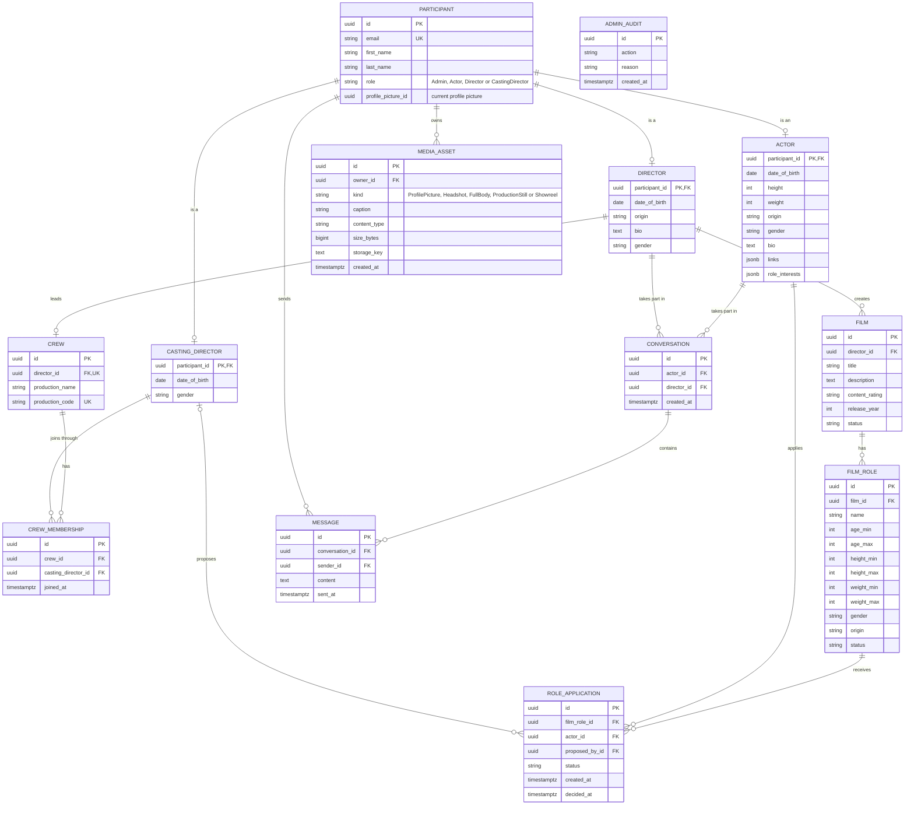

# Casting App

A digital film casting platform. Actors, directors and casting directors manage films, roles and applications and talk to each other in real time. This repository is the practical part of a bachelor's thesis at the Faculty of Electronic Engineering, University of Niš.

The backend lives in `casting-back`. It is a REST API with a SignalR hub for real-time chat; clients (such as a web frontend) talk to it over HTTP and WebSockets.

## Features

- Four account types with role-based access control: Admin, Actor, Director and CastingDirector
- Cookie-based JWT authentication with refresh tokens, lockout after repeated failed logins and forced logout
- Role profiles, films, film roles, production crews (joined with a production code) and role applications
- Real-time chat between actors and directors over SignalR, with a REST fallback
- Media: profile pictures, actor photo portfolios and showreels, stored on disk and served only through authorised endpoints
- Admin API: lock and unlock accounts, force logout, delete accounts, films and conversations, audit log of admin actions
- Per-role privacy rules (for example, the date of birth is visible only to its owner and to admins)
- Redis in three roles: SignalR backplane, cache for media metadata and distributed rate limiting

## Tech stack

.NET 10, ASP.NET Core, Entity Framework Core with Npgsql, PostgreSQL, ASP.NET Core Identity, SignalR, Redis, Docker (PostgreSQL and Redis containers only).

## Architecture

Clean Architecture; dependencies point inwards.

| Project | Responsibility |
|---|---|
| `CastingApp.Domain` | Entities and enums |
| `CastingApp.Application` | Services, DTOs, business rules and the interfaces they depend on |
| `CastingApp.Infrastructure` | EF Core and PostgreSQL, Identity, JWT, Redis, local file storage |
| `CastingApp.Api` | Controllers, SignalR hub, middleware and the composition root (`Program.cs`) |

The Application layer knows only abstractions. Redis, the file system and SignalR are reached through interfaces implemented in Infrastructure or Api.

## Data model

A simplified overview with the key columns only. The exact schema is defined by the EF Core migrations in `CastingApp.Infrastructure`; supporting tables (Identity and refresh tokens) are omitted. `ADMIN_AUDIT` deliberately has no foreign keys, so the audit log survives deleted accounts.



## Getting started

Prerequisites: .NET 10 SDK, Docker, and the EF Core CLI (`dotnet tool install --global dotnet-ef`).

1. Create the Docker settings from the template and edit the values. `.env` must never be committed.

   ```powershell
   Copy-Item .env.example .env
   ```

   `.env` holds `POSTGRES_USER`, `POSTGRES_PASSWORD`, `POSTGRES_DB`, `POSTGRES_PORT` and `REDIS_PORT`.

2. Start PostgreSQL and Redis from the repository root:

   ```powershell
   docker compose up -d
   ```

3. Set the API secrets. The connection strings must match the values from `.env`:

   ```powershell
   cd casting-back
   dotnet user-secrets set "Jwt:Key" "<random value, at least 32 bytes>" --project CastingApp.Api
   dotnet user-secrets set "ConnectionStrings:Postgres" "Host=localhost;Port=<POSTGRES_PORT>;Database=<POSTGRES_DB>;Username=<POSTGRES_USER>;Password=<POSTGRES_PASSWORD>" --project CastingApp.Api
   dotnet user-secrets set "ConnectionStrings:Redis" "localhost:<REDIS_PORT>" --project CastingApp.Api
   ```

   Environment variables work too (`Jwt__Key`, `ConnectionStrings__Postgres`, ...).

4. Apply the migrations:

   ```powershell
   dotnet ef database update --project CastingApp.Infrastructure --startup-project CastingApp.Api
   ```

5. Run the API:

   ```powershell
   dotnet run --project CastingApp.Api
   ```

   The API listens on `http://localhost:5018`. Swagger UI (Development only) is at `/swagger` and lists every endpoint with its request and response shapes. `GET /health` checks PostgreSQL and Redis.

In Development the API seeds sample accounts and data (see `casting-back/CastingApp.Infrastructure/Persistence/DevSeeder.cs`).

## Configuration

Names only; real values belong in user secrets or environment variables.

| Key | Required | Default | Purpose |
|---|---|---|---|
| `ConnectionStrings:Postgres` | yes | | PostgreSQL connection |
| `ConnectionStrings:Redis` | yes | | Redis connection |
| `Jwt:Key` | yes | | Token signing key, at least 32 bytes |
| `Jwt:Issuer`, `Jwt:Audience` | no | `CastingApp` | Token issuer and audience |
| `Jwt:ExpiresMinutes` | no | `15` | Access token lifetime |
| `Jwt:RefreshTokenDays` | no | `30` | Refresh token lifetime |
| `Media:RootPath` | no | `media` next to the binaries | Where uploaded files are stored. Set it outside the repository, otherwise `dotnet clean` deletes the files |
| `Admin:Email`, `Admin:Password` | no | | If both are set, the first admin is created at startup. An existing account is never modified. `Admin:FirstName` and `Admin:LastName` are optional |
| `Cache:MediaMetadataSeconds` | no | `300` | Lifetime of cached media metadata; `0` turns the cache off |

## Using the API

### Accounts and roles

Registration asks for first name, last name, email, password and a role. Until the profile is complete the account is restricted (for example, it cannot send chat messages).

| Role | What it does |
|---|---|
| Actor | Keeps a profile, photo portfolio and showreels; takes part in role applications; chats with directors |
| Director | Leads a crew (identified by a production code), creates films and film roles, views actor portfolios, chats with actors |
| CastingDirector | Joins a crew with its production code (`POST /api/crews/join`), views actor portfolios, proposes actors for film roles |
| Admin | Manages accounts, films and conversations through `/api/admin`; sees private fields; does not take part in chat |

Role applications move through the statuses `Proposed`, `Accepted` and `Rejected`.

### Authentication

Register, login and session refresh live under `/api/auth`. Login sets two httpOnly cookies: `casting_auth` (access token, 15 minutes by default) and `casting_refresh`. Clients send the cookies with every request; there is no token to copy into a header. Five failed logins lock an account for 15 minutes.

Browser clients on `http://localhost:5173` (the Vite dev server) may call the API with credentials.

### Real-time chat

A director opens a conversation with an actor (`POST /api/conversations`) and either side sends messages through REST (`POST /api/conversations/{id}/messages`) or through the SignalR hub at `/hubs/chat`, which uses the same cookie. Both paths share the same rules. Every message is stored in PostgreSQL and delivered to both participants as the `MessageReceived` event. Locked accounts and incomplete profiles cannot send, and one sender is limited to 20 messages per minute per conversation. History is available at `GET /api/conversations/{id}/messages`.

### Media

| Endpoint | Purpose |
|---|---|
| `PUT /api/me/profile-picture`, `DELETE /api/me/profile-picture` | Set or remove your profile picture |
| `GET /api/participants/{id}/profile-picture` | View a profile picture |
| `POST /api/me/photos` | Actors upload a photo (`Kind`: `Headshot`, `FullBody` or `ProductionStill`; optional `Caption`) |
| `POST /api/me/showreels` | Actors upload a showreel |
| `GET /api/actors/{id}/photos`, `GET /api/actors/{id}/showreels` | List an actor's portfolio |
| `GET /api/media/{id}` | Download a file |
| `DELETE /api/me/media/{id}` | Delete one of your files |

Accepted files: JPEG, PNG and WebP images (5 MB for profile pictures, 10 MB for photos) and MP4 or WebM showreels (200 MB). The type is detected from the file content, not from its name. Per account: up to 5 headshots, 5 full-body photos, 10 production stills and 3 showreels. A new upload always gets a new id.

Who can view what: portfolios are visible to the owner, directors, casting directors and admins. A director's profile picture is visible to every signed-in user; an actor's or casting director's picture only to directors and casting directors (and to the owner and admins). Permissions are checked on every request.

### Privacy

The date of birth is visible only to its owner and to admins (the age stays visible). A crew's production code is visible only to its director, its members and admins.

### Admin

Admins can lock and unlock accounts, force a logout, and delete accounts, films and conversations. Every action needs a reason and is recorded in the audit log. Admin accounts, including your own, cannot be locked or deleted through the API. An admin account can be created at startup from configuration (`Admin:Email`, `Admin:Password`).

### Errors

Errors are returned as problem details (`application/problem+json`) with a title and a detail. Status codes: `400` invalid request, `401` not signed in, `403` not allowed, `404` not found, `409` conflict and `429` too many requests (with a `Retry-After` header).

### Rate limits

| Policy | Limit | Scope |
|---|---|---|
| All `/api` and `/hubs` requests | 300 per minute | user, or IP address if not signed in |
| Register and login | 10 per minute | IP address |
| Session refresh | 30 per minute | IP address |
| Joining a crew | 5 per 10 minutes | user |
| Image uploads | 30 per 10 minutes | user |
| Showreel uploads | 5 per 10 minutes | user |

## Redis

The compose file runs Redis capped at 256 MB with an `allkeys-lru` eviction policy. It holds only derived or short-lived data, never the source of truth, which is PostgreSQL.

1. SignalR backplane, so a message sent through one API instance reaches clients connected to another.
2. Cache-aside for media metadata (owner, kind, type, storage key), invalidated on replace and delete. Permissions are still checked on every request.
3. Distributed fixed-window rate limiting (atomic Lua script), shared by all API instances and kept across restarts.

If Redis is unavailable the API falls back to PostgreSQL for media metadata and to an in-memory limiter, and logs a warning.